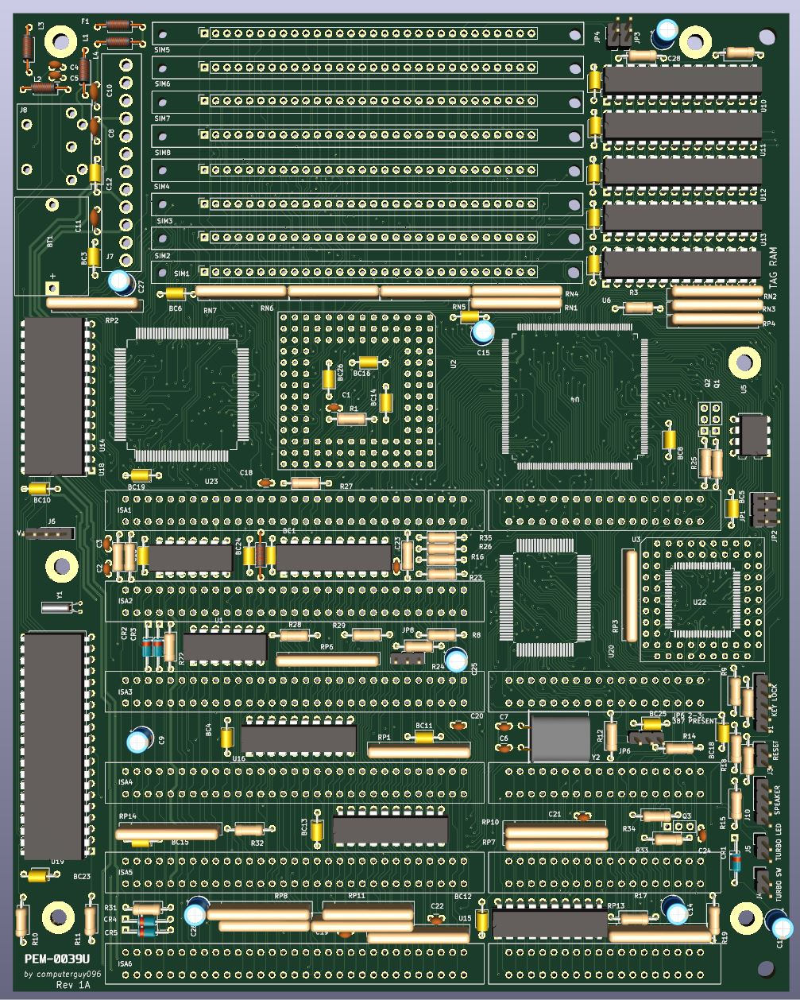

# DTK 386 replica

This is an open source replica of the [DTK PEM-0039U](https://theretroweb.com/motherboards/s/gemlight-gmb-386umc), and its main target was to reverse engineer the pinout and functionality of the UMC 82C491 chipset, for which there are no datasheets online.

Theoretically, it should be fully functional if one were to assemble this, but I do not guarantee there won't be bugs from my side or from the original designers which made it 30+ years ago. The aim was to 100% reproduce the original PCB, with all the original components and footprints, despite the questionable trace routing in certain places.

The gerber files can be found at `/gerber`.

Special thanks to:
- Rigo for providing some useful footprints on his [retro kicad repo](https://github.com/rigred/kicad-retro)
- Sergey for some more useful footprints and symbols, from the [sandy river 486 repo](https://github.com/skiselev/sandy_river_486)

